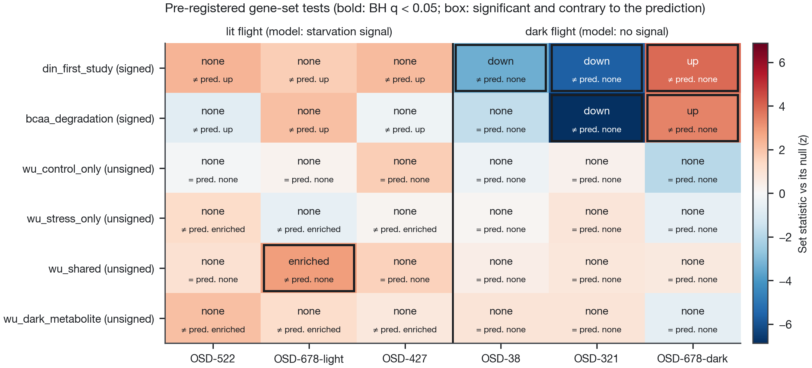

# Natural variation in *Arabidopsis* light/dark metabolism tests a spaceflight carbon-starvation model

**A gas-transport model of the BRIC-LED-001 flight (OSD-522) predicted that microgravity starves
lit plants of carbon, so lit spaceflight transcriptomes should carry a carbon-starvation signature
and dark ones should not. Measured light/dark metabolism from hundreds of natural accessions
confirms the model's metabolic picture in outline and corrects it in detail. Pre-registered
tests on six flight contrasts find the starvation signal strongest in the dark, where the model
predicts none.**

[**Story page**](https://dr-richard-barker.github.io/spaceflight-metabolism-natural-variation/)
· [manuscript PDF](manuscript/latex/main.pdf) · [manuscript DOCX](manuscript/latex/main.docx)
· [Supplementary Information](manuscript/latex/supplementary.pdf)
· [figures](results/figures) · [tables](results/tables) · [pre-registration](prereg/PREDICTIONS.md)



## What is new

The first study ([Photorespiration_multiomics_microgravity](https://github.com/dr-richard-barker/Photorespiration_multiomics_microgravity),
read here at commit 515226d) predicted the OSD-522 metabolome from a model, because NASA's Open
Science Data Repository holds no plant metabolome. This study tests those predictions, and the
model's light/dark claim, with measured natural-variation data:

- **Zhu et al. 2024**: 259 accessions with leaf metabolomes before and after 6 days of darkness
- **Wu et al. 2018**: 301 accessions with paired control and darkness-stress (32 °C) values, and
  their metabolite GWAS loci per condition
- **Caldana et al. 2011**: a light/dark time course (from the Wu supplement)
- **MetaboLights**: Col-0 control groups from six GC-MS studies, for replicate variance
- **OSD-38 (BRIC-20)**: 3-day dark-grown Col-0 seedlings in sealed BRIC-PDFU canisters, flight and
  ground, with RNA-seq and iTRAQ membrane and soluble proteomes (Kruse et al. 2020), plus a ground
  BRIC-PDFU vs closed-container comparison (Basu et al. 2017)

## Findings

1. **The model's metabolite directions mostly hold, its grouping does not.** The reference is an
   extended-darkness, direction-of-change reference, not a measure of a mild deficit. Of the 6
   predicted compounds it can test, 5 agree (maltose down; asparagine, valine, leucine, isoleucine
   up). Glutamate, which the model raises with them, falls, but only in Wu's 32 °C dark+heat
   source; glutamine has no direction; leucine responds 2.7–2.8 times as strongly as valine or
   asparagine. 41 robust darkness responses were not predicted, including malate and
   2-oxoglutarate (both fall). The BCAA rise and the malate/2-OG fall hold at every threshold tried.
   [T03](results/tables/T03_model_vs_reference.tsv), [fig01](results/figures/fig01_model_vs_reference.png)
2. **A measured metabolite layer leaves PaintOmics unchanged.** Swapping the 21 predicted
   compounds for 96 measured ones kept the same 6 significant pathways (rank correlation 0.95),
   and raw hub p-values were identical for every shared compound. Control jobs (revision) show the
   same with no metabolite layer or with rescaled values; hubs need genes and proteins together,
   and they follow the number of differentially expressed genes.
   [T04–T07](results/tables), [fig02](results/figures/fig02_jobA_vs_job1.png)
3. **The starvation signal is not light-specific.** 18 of 36 pre-registered outcomes matched,
   but no lit contrast gave a significant starvation signal, while the starvation (DIN) and
   branched-chain amino acid catabolism sets moved strongly in three dark contrasts, down in
   BRIC-PDFU seedlings and up in the leaves of dark-grown CARA seedlings. GWAS-locus gene sets showed nothing
   light-specific. [T08](results/tables/T08_geneset_tests.tsv), [fig04](results/figures/fig04_geneset_tests.png)
4. **The predicted metabolite shifts are too small for a feasible panel.** With 6 plants per arm,
   GC-MS detects about 1.48-fold changes at best; the model's 0.13 log₂ needs 92–1,342 plants per
   arm. [T10](results/tables/T10_gcms_power.tsv), [fig05](results/figures/fig05_gcms_power.png)
5. **In a dark sealed BRIC, proteins move against transcripts.** In OSD-38 all four KEGG carbon
   pathways rise in the transcriptome but fall in the membrane fraction of the proteome (q
   0.0005–0.014, robust to abundance-matched random sets and to limma); the soluble subset does not
   follow. BCAA degradation is flat at both levels. On the ground, the pre-registered hypoxia and
   fermentation sets are null in GeneLab's BRIC-PDFU vs air-tight container comparator, but a
   positive control shows the hypoxia set cannot detect hypoxia, and an independent hypoxia
   signature rises strongly in the BRIC (revision, post hoc). The leucine, isoleucine and glutamate
   hubs of the lit OSD-522 canister appear in the dark one too, at an overlap no larger than chance.
   [T11–T13](results/tables), [fig06](results/figures/fig06_osd38.png),
   [fig07](results/figures/fig07_bric_lit_vs_dark.png)

Labels used throughout: the PaintOmics metabolite layer here is a **ground carbon-starvation
reference, not flight measurements**.

## Revision 1 (post hoc)

A reviewer's 16 points were answered with analyses planned in `prereg/revision1/` (commit 90ff4b8,
hypoxia-signature addendum 8d6a9ae) before they ran: reference strata and threshold sensitivity
(T14–T16), PaintOmics control jobs E–K2 and a hub-overlap null (T17, T18), an OSD-678 flight × light
model (T19), rotation-null calibration, exact permutation and DIN checks (T20–T22), OSD-38 proteome
checks (T23), a hypoxia positive control (T24, T25) and MetaboLights provenance (T26). They are in
the Supplementary Information. The pre-registered outputs (T02, T08, T12, T03 verdicts) are
unchanged. The response letter quotes confidential review comments and is kept out of the repository.

## Pre-registration

`prereg/` (gene sets, genome order, settings, predicted outcomes) was committed in 858ca21,
before any gene-set statistic was computed on a flight contrast; the tests came in 0d07084.
`scripts/16_gwas_light_dark_tests.py` reads `prereg/` and will not run without it. The DIN set and
the compound comparison are flagged there as re-tests and consistency checks, since the first
study's results and the reference had been seen. The OSD-38 addendum, `prereg/osd38/`, was
committed in eb005ec, before any OSD-38 protein or hardware statistic was computed; its tests came in
488d801 (`scripts/22_osd38_tests.py`).

## Layout

| Path | Contents |
|---|---|
| `data/atlas/`, `data/photoresp/` | inputs read with `git show` from the two sibling repositories (`PROVENANCE.md`: commit, path, SHA-256) |
| `data/osdr/` | per-contrast GeneLab statistics for OSD-38, OSD-321, OSD-678 light and dark, OSD-427 |
| `data/reference/` | KEGG name map and reviewed overrides, MetaboLights sources and derived SDs |
| `data/paintomics_upload/` | the three PaintOmics bundles and the layer key |
| `prereg/` | the frozen pre-registration; `prereg/osd38/` the OSD-38 addendum; `prereg/revision1/` the post hoc revision plan |
| `scripts/` | numbered analysis scripts; `run_all.sh` runs them in order |
| `results/tables/`, `results/figures/` | T01–T26 (see `MANIFEST.tsv`), fig01–fig07, figS1–figS3 |
| `results/paintomics_raw/` | recovered PaintOmics job records (guest jobs expire after 7 days) |
| `manuscript/latex/` | manuscript and Supplementary Information sources, generated `numbers.tex` and `supp_tables.tex`, PDFs and DOCX |
| `docs/` | the GitHub Pages story page |

## Reproduce

```bash
./run_all.sh          # every table, figure and manuscript number, byte-identical
./run_all.sh --pdf    # also the manuscript PDF and DOCX
python3 scripts/check_references.py   # every DOI against CrossRef
```

Python 3.9 with pandas, numpy, scipy, matplotlib and PyDESeq2 0.4.12; R with limma and edgeR for
the revision analyses (tested with limma 3.68.5, edgeR 4.10.5). Raw third-party files
(the Wu supplement, KEGG lists, MetaboLights study files) are fetched into the git-ignored
`data/cache/`; only derived values are committed. PaintOmics jobs are not re-submitted: their
records are vendored.

## Data sources and licences

- NASA OSDR: OSD-522, OSD-38, OSD-321, OSD-678, OSD-427, OSD-136 (public domain, CC0); GEO GSE14502
  (Mustroph et al. 2009) for the hypoxia positive control. OSDR's processed
  OSD-38 proteome tables (CSV and xlsx) are truncated at 65,535 rows: only soluble protein groups
  1–437 and the first membrane block are usable (`scripts/20_osd38_inputs.py`)
- Zhu et al. 2024 (*Sci Data*, doi:10.1038/s41597-024-03694-2) and Wu et al. 2018 (*Mol Plant*,
  doi:10.1016/j.molp.2017.08.012), as derived tables in the
  [Arabidopsis Atlas](https://github.com/dr-richard-barker/arabidopsis-atlas) (commit 69b21c6)
- Caldana et al. 2011 (*Plant J*, doi:10.1111/j.1365-313x.2011.04640.x), via Wu et al.'s
  supplementary tables 7–8; only derived ratios are committed
- MetaboLights MTBLS22, 41, 42, 363, 2289, 4066 (EMBL-EBI terms of use); only derived SDs are
  committed
- KEGG REST API (compound names, ChEBI conversion, gene lists, pathway membership)

Code: MIT (`LICENSE`).

## Open items

- Zenodo deposit (manual)
- Manuscript authorship, affiliation, funding and AI-use statements (`manuscript/latex/README.md`)
- OSD-38's soluble proteome: only the top 437 protein groups survive OSDR's truncated table; the
  raw iTRAQ files in OSDR would have to be re-searched to recover the rest
